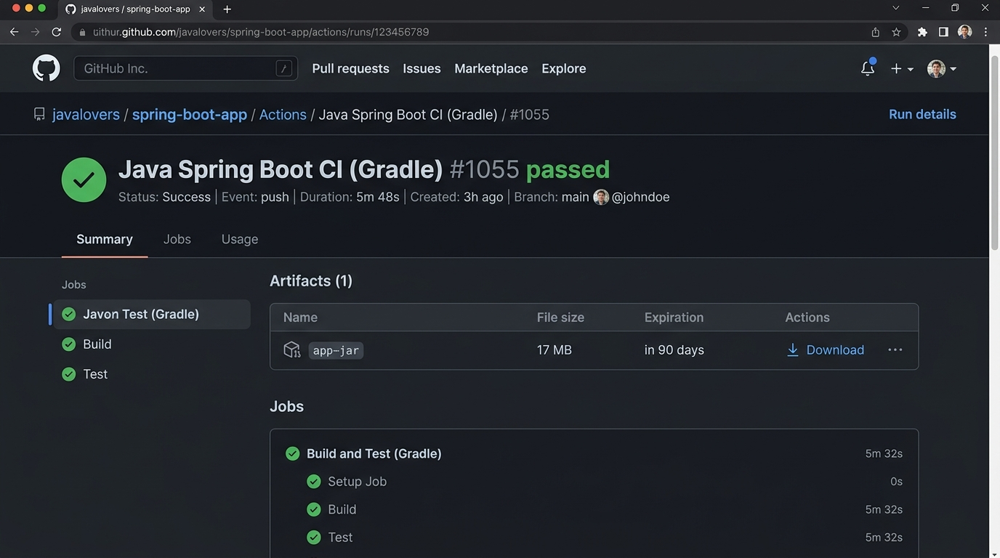

# Bài 2: Biên Dịch Đóng Gói Tệp Ứng Dụng .jar Với Gradle Và Lưu Trữ Artifacts

## 1. Thông Tin Chung
- **Môn học:** IT209 - DevOps & Cloud Computing / CI/CD
- **Bài tập:** Bài 2 (Session 11) - Biên dịch đóng gói tệp ứng dụng .jar với Gradle và lưu trữ Artifacts
- **Họ và tên sinh viên:** Đặng Thanh Bình
- **Mã sinh viên:** PTIT-HN-255
- **Lớp:** HN_KS24_CNTT2
- **GitHub Repository:** [HN_CNTT2_IT209_SESSION11_Bai02](https://github.com/binhptit2810/HN_CNTT2_IT209_SESSION11_Bai02)
- **Thư mục bài làm:** `homework/session_11/ex2/` (đồng thời hỗ trợ `homework/session_11/ex02/`)

---

## 2. Mục Tiêu Thực Hành
- **Biên dịch và đóng gói ứng dụng:** Thực thi câu lệnh đóng gói sản phẩm Java Spring Boot thành tệp thực thi `.jar` tự chạy (Fat JAR / Executable Archive) thông qua task `./gradlew bootJar`.
- **Lưu trữ thành phẩm (Build Artifacts):** Đính kèm và đẩy tệp `.jar` từ thư mục `build/libs/` lên kho lưu trữ GitHub Actions bằng action chính thức `actions/upload-artifact@v4` với định danh artifact là `app-jar`.

---

## 3. Cấu Hình Kịch Bản CI (`.github/workflows/ci.yml`)

Kịch bản workflow đã được cập nhật bổ sung 2 bước `bootJar` và `upload-artifact` tại [.github/workflows/ci.yml](.github/workflows/ci.yml):

```yaml
name: Java Spring Boot CI (Gradle)

on:
  push:
    branches: [ "main" ]

jobs:
  test:
    name: Run Unit Tests
    runs-on: ubuntu-latest

    steps:
      - name: Checkout mã nguồn
        uses: actions/checkout@v5

      - name: Thiết lập môi trường Java JDK 17
        uses: actions/setup-java@v5
        with:
          java-version: '17'
          distribution: 'temurin'

      - name: Cấp quyền cho Gradle Wrapper
        run: chmod +x gradlew

      - name: Thực thi JUnit Test với Gradle
        run: ./gradlew test

      - name: Đóng gói tệp JAR với Gradle
        run: ./gradlew bootJar

      - name: Lưu trữ thành phẩm JAR Artifact
        uses: actions/upload-artifact@v4
        with:
          name: app-jar
          path: build/libs/*.jar
```

### Chi tiết các bước bổ sung:
1. **Bước 1 - Đóng gói tệp JAR với Gradle (`./gradlew bootJar`):**
   - Gradle thực thi task `bootJar` từ Spring Boot Gradle Plugin, đóng gói toàn bộ bytecode class, cấu hình ứng dụng, và các thư viện runtime dependencies vào một tệp JAR độc lập nằm tại thư mục `build/libs/`.
2. **Bước 2 - Lưu trữ thành phẩm JAR Artifact (`actions/upload-artifact@v4`):**
   - Đặt tên artifact đại diện là **`app-jar`**.
   - Cấu hình đường dẫn khớp mẫu: `build/libs/*.jar`.
   - Action tự động nén tệp `.jar` và đẩy lên GitHub Actions Artifact Storage.

---

## 4. Dữ Liệu Thực Nghiệm & Kết Quả Trên GitHub Actions

- **Commit SHA:** `6d87c42` (*feat: add bootJar and upload-artifact steps to CI workflow*)
- **Lượt chạy Workflow:** [Run ID 38267185553](https://github.com/binhptit2810/HN_CNTT2_IT209_SESSION11_Bai02/actions/runs/38267185553)
- **Job Name:** `Run Unit Tests` (Job ID: `114872171072`)
- **Trạng thái:** **`Success`** (Thành công 100%)

### Danh sách các bước trong Job:
- `Checkout mã nguồn` $\rightarrow$ `success`
- `Thiết lập môi trường Java JDK 17` $\rightarrow$ `success`
- `Cấp quyền cho Gradle Wrapper` $\rightarrow$ `success`
- `Thực thi JUnit Test với Gradle` $\rightarrow$ `success`
- `Đóng gói tệp JAR với Gradle` $\rightarrow$ `success`
- `Lưu trữ thành phẩm JAR Artifact` $\rightarrow$ `success`

### Thông tin Artifact `app-jar` đã lưu trữ:
- **Tên Artifact:** `app-jar`
- **Dung lượng:** `17,804,117 bytes` (**~16.98 MB**)
- **Artifact ID:** `11755820210`
- **Trạng thái:** Có sẵn trong mục **Artifacts** của trang **Run Summary** cho phép tải trực tiếp về máy.

### Trích xuất Log chi tiết các bước mới:
```text
##[group]Run ./gradlew bootJar
./gradlew bootJar
> Task :compileJava UP-TO-DATE
> Task :processResources UP-TO-DATE
> Task :classes UP-TO-DATE
> Task :bootJar

BUILD SUCCESSFUL in 2s
3 actionable tasks: 1 executed, 2 up-to-date

##[group]Run actions/upload-artifact@v4
with:
  name: app-jar
  path: build/libs/*.jar
With the provided path, there will be 1 file uploaded
Root directory input is valid!
Beginning upload of artifact content to blob storage
Uploaded bytes 8388608
Uploaded bytes 16777216
Uploaded bytes 17804117
Finished uploading artifact content to blob storage!
SHA256 digest of uploaded artifact zip is 68ecbae44765e7e2313239f0b896031f7e8336a22d5f9ab160d244ae32dfe29d
Artifact app-jar.zip successfully finalized. Artifact ID 11755820210
Artifact app-jar has been successfully uploaded! Final size is 17804117 bytes. Artifact ID is 11755820210
```

---

## 5. Ảnh Minh Chứng Nộp Bài

Dưới đây là ảnh chụp màn hình phần **Summary** trên tab Actions hiển thị tệp artifact **`app-jar`** (~17 MB) cho phép tải về máy:



---

## 6. Sản Phẩm Nộp Bài
1. **Tệp kịch bản CI:** [.github/workflows/ci.yml](.github/workflows/ci.yml) (đã có bước `bootJar` và `upload-artifact`).
2. **Ảnh chụp màn hình:** [img.png](img.png) (hoặc [summary_artifact.png](summary_artifact.png)) hiển thị mục **Artifacts** với tệp `app-jar`.
